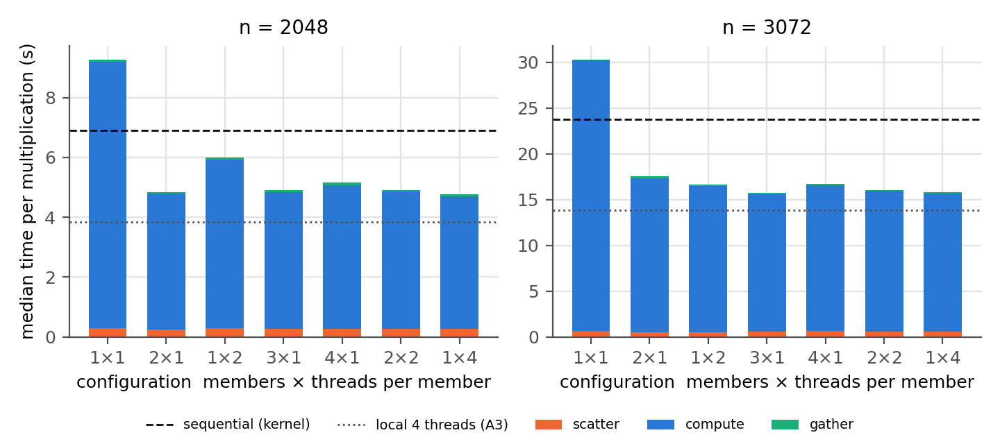
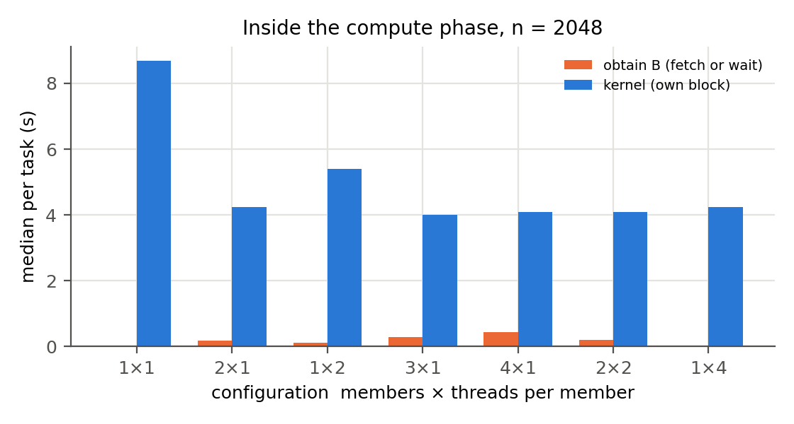
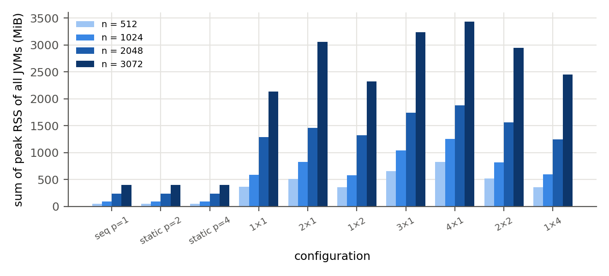
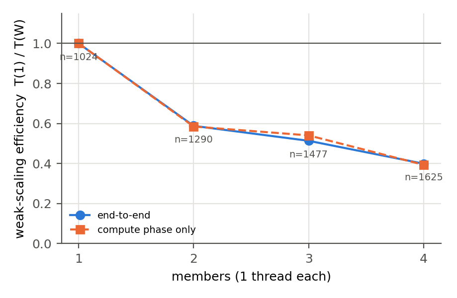

# Abstract

I built a distributed dense matrix multiplication in Java on top of Hazelcast 5.5,
an in-memory data grid, and measured how it scales with the number of workers. A and
C are cut into row blocks stored in distributed maps; each block is multiplied on the
cluster member that stores it, by the same i-k-j kernel used in Assignments 2 and 3,
and every member fetches a full copy of B once per multiplication. I compared seven
configurations (1–4 member processes × 1–4 threads) with the sequential kernel and
the shared-memory parallel version of Assignment 3, on the same float64 inputs, for
n = 512 to 3072. **All members ran on one laptop with 2 physical cores**, so the
study measures framework and data-movement costs, not a real network. All versions
give bit-identical results. For n ≥ 2048 the distributed code was 1.73–1.95 times
faster with two or more workers than with one, but against the sequential kernel its
best end-to-end speedup was 1.45 (n = 2048) and 1.50 (n = 3072), about 80–85 % of the
local thread pool's speed. Moving A, B and C between the driver and the members took
3–7 % of the time for n ≥ 2048 but 15–27 % at n = 512, where no distributed
configuration beat the local pool. The redistribution of B grew with the number of
members (up to 1.0 s at n = 3072 with 4 members). Beyond 2 workers there was no gain
because the hardware has 2 cores. The distributed runs used 5–16 times more memory
than the local ones, and starting a 4-member cluster took about 13 s. Weak-scaling
efficiency fell to 0.40 at 4 workers. The conclusions are limited to this code, these
settings and this single machine.

# 1. Introduction and objective

Assignment 3 used both cores of my laptop from one process with a thread pool. The
next step is to split the work between separate processes that only share data
through a distributed framework, which is how a computation would run on a real
cluster. Even on one machine this shows what the framework costs: serialization,
copies, task scheduling, extra JVMs and memory.

**Research question.** How does a distributed matrix multiplication built on
Hazelcast scale when workers are added, and how much of its time goes to
computation, data movement and framework overhead, compared with the sequential
and shared-memory parallel versions of the same kernel?

**Secondary questions.** (a) Is it better to add worker *processes* (members) or
worker *threads* inside one member? (b) How large is the data movement and how does
it grow with the number of members? (c) What does the distributed version cost in
memory and start-up time? (d) How does it behave under weak scaling?

**Hypotheses.**

* H1: with one worker the distributed version is slower than the sequential kernel
  (copies, serialization, task scheduling), and the gap shrinks as n grows because
  the work grows as n³ and the data as n².
* H2: the distributed code scales up to 2 workers (2 physical cores) and gains little
  or nothing beyond, as the thread pool did in Assignment 3.
* H3: for small n the data movement is a large part of the time and the distributed
  version loses against the local thread pool.
* H4: adding members costs more than adding threads, because each member needs its
  own copy of B and its own JVM.
* H5: memory grows with the number of members.

# 2. Background

**Row-block distribution.** For C = A·B, row block i of C needs row block i of A and
all of B. A one-dimensional (row-block) distribution therefore keeps A and C
partitioned and replicates B, which costs O(n²) communication per worker. Two-
dimensional algorithms such as Cannon's [1] and SUMMA [2] also partition B and send
less data per worker when many processes are used [3]. With at most 4 workers and
matrices that fit in memory, the row-block scheme is the simplest correct choice;
its B redistribution cost is measured explicitly here.

**Hazelcast.** Hazelcast is an open-source in-memory data grid for the JVM [4]. Data
is stored in distributed maps (`IMap`); each key is hashed into one of 271
partitions, and each partition is owned by one cluster member [5]. The distributed
executor (`IExecutorService`) runs `Callable` tasks on members; `submitToKeyOwner`
runs a task on the member that owns a given key, which keeps the computation next to
its data [6]. Clients connect to the cluster without storing data [7]. Values are
stored in serialized form (BINARY format by default), so every put and get copies
and (de)serializes the array [8].

**Strong and weak scaling.** In strong scaling the problem size is fixed while the
resources grow; Amdahl's law [9] bounds the speedup by the serial part. In weak
scaling the problem grows with the resources [10]. Dense multiplication costs 2n³
operations, so keeping the work per worker constant with W workers requires
n = n₀·W^(1/3); keeping n per worker constant would not give equal work.

**Floating-point results.** Java uses strict IEEE 754 semantics since Java 17
(JEP 306) [11]. All kernels add the products of each C[i][j] in the same order
k = 0…n−1, so all results must be bit-identical; any difference reveals a bug.

# 3. Methodology

## 3.1 Implementations

All code is written in Java 21; the only library is Hazelcast 5.5.0 (open source).

| Method | Description | Processes |
|---|---|---|
| `seq` | Sequential i-k-j kernel, unchanged from A2/A3 (`Kernels.ikj`) | 1 JVM, 1 thread |
| `static` p | A3 parallel version: fixed thread pool, p static row blocks (`Parallel.StaticRows`) | 1 JVM, p threads |
| `hazelcast` m×t | Distributed version: m member JVMs, each with an executor of t threads; workers = m·t | m members + 1 driver |

*Reused code.* `Kernels.java` is copied unchanged from Assignment 3 (repository
`amaisuarez/assignment3`, commit `b8447c5`); `Parallel.java` is copied with only the
Vector API kernel removed; `LocalMatMul.java` is A3's `MatMul3.java` without the
Vector API methods. The inputs and their generator are the A1–A3 files.

**Distributed design** (`DistMatMul.java`, `BlockTask.java`, `ClusterMember.java`).

* *Processes.* Each member is a separate JVM. The driver is a Hazelcast client: it
  stores no data and runs no tasks.
* *Partitioning.* A and C are cut into P = m·t row blocks (sizes differ by at most one
  row); block b belongs to member b mod m, so every member gets t blocks, one per
  executor thread. B is cut into m row panels, one per member.
* *Placement.* Because Hazelcast places keys by hashing, the driver searches (once,
  before timing) for keys whose partition is owned by the wanted member. The task
  for block b is sent with `submitToKeyOwner` on the key of its A block, so it runs
  where that block is stored, and it writes its C block under the same key, on the
  same member. All 450 measured tasks ran with their A block local.
* *Replicating B.* The first task of each member that starts in a multiplication
  fetches all B panels with one `getAll` (the other members' panels travel through
  the loopback interface) and builds a full copy of B; the other tasks of that member
  wait for it and reuse it. B is therefore transferred once per member:
  8n²(m−1)/m bytes per member.
* *Kernel.* Each task runs `Kernels.ikjRows` (the A3 row kernel) on its block.
* *Settings* (`HzSetup.java`): backups disabled (backup-count 0), so every value is
  stored once; TCP/IP discovery on 127.0.0.1 only; executor pool size t; a new
  cluster with a unique name for every configuration.

## 3.2 Inputs, sizes and configurations

The inputs are the A1–A3 files: values uniform in [−1, 1), seed `20262027`, float64,
byte-identical (SHA-256 checked). Strong scaling: n = 512, 1024, 2048, 3072 with the
configurations 1×1, 2×1, 3×1, 4×1 (adding processes), 1×2, 1×4 (adding threads) and
2×2. The references `seq`, `static` p = 2 and p = 4 were measured in the same session.
Weak scaling: W = 1…4 members with one thread each and n = round(1024·W^(1/3)) =
1024, 1290, 1477, 1625, so each worker does 2.15 GFLOP.

## 3.3 Environment

| Item | Value |
|---|---|
| Machine | **1 physical machine**; all members and the driver on it, loopback 127.0.0.1 |
| CPU | Intel Core i5-5350U @ 1.80 GHz, 2 physical cores / 4 logical (Hyper-Threading) |
| Caches / RAM | 32 KiB L1d, 256 KiB L2 per core, 3 MiB L3; 8 GiB RAM |
| OS / Java | macOS (Darwin 21.6.0) / OpenJDK 21.0.6 |
| Hazelcast | 5.5.0 open source (jar SHA-256 `cf560b40…a19e`) |
| JVM options | members `-XX:+UseSerialGC -Xms128m -Xmx1g`; driver `-Xmx2g`; local `-Xmx4g` (all SerialGC) |
| Power | AC adapter; laptop not used during the runs |

*Workers, processes and machines.* "Workers" = executor threads that run tasks
(m·t). Each member is one process; all processes ran on one machine. Each JVM also
runs Hazelcast's own threads (I/O, partition operations; the members reached
49–65 threads in total) and the JIT and GC threads. No CPU affinity: macOS does not
allow pinning.

## 3.4 Correctness

`tests/validate.py` was run before the benchmarks and passed all checks
(`results/validation_report.txt`): identity, zero and a hand-computed 2×2 product for
every method and four cluster configurations (1×1, 2×1, 2×2, 3×1); `seq` against
NumPy within the forward error bound |C − Ĉ| ≤ 2γₙ|A||B| (γₙ = nu/(1−nu), u = 2⁻⁵³)
[12]; the distributed result equal to `seq` **bit for bit** for n = 1…131, including
n smaller than the number of blocks (empty blocks) and n not divisible by it; the
same checksum in every multiplication of a driver process; and, for every
multiplication, A local in all tasks, B fetched exactly once per member, and the
remote B bytes equal to 8n(n − rows of the member's own panel). In the study itself
C was filled with NaN before each multiplication and the checksum of every
multiplication equalled the sequential one.

## 3.5 Measurement protocol

* *Timing boundaries.* Local runs: one multiplication call (kernel only, as in A3).
  Distributed runs: **end-to-end inside the driver** = scatter (cut A and B into
  blocks and `putAll` them) + compute (submit all tasks and wait for them; includes
  the B redistribution, the kernels and storing C) + gather (`getAll` of C and
  assembly). The three phases run one after the other, so they can be added. Not
  included: reading the files, starting the cluster, connecting the client and the
  untimed cleanup after each multiplication; start-up and connection are reported
  separately. Inside the compute phase tasks overlap, so their own timings (read A,
  obtain B, kernel, store C) are reported per task and never added.
* *Timer.* `System.nanoTime()` (monotonic); durations only, clocks of different
  processes are never compared.
* *Warm-up and repetitions.* 2 warm-up multiplications for n ≤ 1024, 1 above (A3
  rule for local runs), excluded from the statistics; 5 measured multiplications per
  configuration; median and interquartile range (IQR). Speedups use medians.
* *Order.* Configurations shuffled within each size with a fixed seed.
* *Memory.* Peak resident set size of every JVM from `wait4` (`ru_maxrss`); per member
  also heap in use after a GC and Hazelcast's `getOwnedEntryMemoryCost` of the stored
  map entries; analytical array storage 3·8n².
* *Transfers.* Payload bytes (8 per element, serialization headers not counted):
  scatter 16n², gather 8n², B redistribution 8n²(m−1) in total. There is no physical
  network: transfers are loopback copies, and network costs cannot be isolated from
  serialization.
* *Budgets, declared beforehand.* 120 s per multiplication and 4 GB of estimated data
  in all processes. No configuration exceeded them: **all 48 configurations finished**
  (largest tested and attempted size n = 3072; total peak RSS 3.4 GiB at most).

# 4. Results

All results are from run `results/run_20261124-095140` (34 min). IQRs are in
`report/tables/strong_all.md`; they were below 8 % for 28 of the 40 strong-scaling
configurations and at most 23 %.

## 4.1 Strong scaling

*Table 1. Median time per multiplication. Local: kernel only. HZ m×t: end-to-end.*

| n | seq | static p=2 | static p=4 | HZ 1×1 | HZ 2×1 | HZ 1×2 | HZ 3×1 | HZ 4×1 | HZ 2×2 | HZ 1×4 |
|---|---|---|---|---|---|---|---|---|---|---|
| 512 | 116.5 ms | 94.2 ms | **66.7 ms** | 191.0 ms | 187.8 ms | 109.0 ms | 138.4 ms | 206.6 ms | 126.7 ms | 104.4 ms |
| 1024 | 978.8 ms | 553.7 ms | **494.9 ms** | 1.18 s | 770.0 ms | 667.2 ms | 711.8 ms | 861.3 ms | 737.1 ms | 608.1 ms |
| 2048 | 6.91 s | 3.99 s | **3.84 s** | 9.28 s | 4.84 s | 5.99 s | 4.94 s | 5.26 s | 4.92 s | 4.76 s |
| 3072 | 23.74 s | **13.47 s** | 13.84 s | 30.32 s | 17.55 s | 16.63 s | 15.91 s | 16.69 s | 16.06 s | 15.79 s |

*Table 2. Speedups (medians). S_seq = T_seq / T_HZ; S_1×1 = T_HZ(1×1) / T_HZ.*

| n | S_seq 1×1 | best S_seq (config) | S_1×1 with 2 workers (2×1 / 1×2) | best S_1×1 | local static best S_seq |
|---|---|---|---|---|---|
| 512 | 0.61 | 1.12 (1×4) | 1.02 / 1.75 | 1.83 | 1.75 |
| 1024 | 0.83 | 1.61 (1×4) | 1.53 / 1.76 | 1.93 | 1.98 |
| 2048 | 0.74 | 1.45 (1×4) | 1.92 / 1.55 | 1.95 | 1.80 |
| 3072 | 0.78 | 1.50 (1×4) | 1.73 / 1.82 | 1.92 | 1.76 |

## 4.2 Where the time goes

*Table 3. Phases of the end-to-end time (medians) and share of scatter + gather.*

| n | config | scatter | compute | gather | (scatter+gather)/total |
|---|---|---|---|---|---|
| 512 | 1×1 / 1×4 | 22.5 / 21.2 ms | 155.1 / 76.3 ms | 6.5 / 7.3 ms | 15 % / 27 % |
| 1024 | 1×1 / 1×4 | 89.8 / 64.6 ms | 1.09 s / 517.6 ms | 19.6 / 17.7 ms | 9 % / 14 % |
| 2048 | 1×1 / 1×4 | 288.4 / 274.5 ms | 8.91 / 4.42 s | 72.7 / 62.7 ms | 4 % / 7 % |
| 3072 | 1×1 / 1×4 | 631.0 / 584.1 ms | 29.56 / 15.07 s | 133.8 / 146.4 ms | 3 % / 5 % |

Scatter moved 16n² bytes at 136–294 MiB/s and gather 8n² bytes at 211–561 MiB/s,
nearly independent of the configuration (`report/tables/transfers.md`).

*Table 4. Inside the compute phase: median per task (n = 3072).*

| config | obtain B (fetch or wait) | B fetch by the fetching task | remote B per member | kernel of own block | store C |
|---|---|---|---|---|---|
| 1×1 | 110.9 ms | 110.8 ms | 0 MiB | 29.14 s | 239.0 ms |
| 1×4 | 67.7 ms | 74.1 ms | 0 MiB | 14.72 s | 154.1 ms |
| 2×1 | 435.4 ms | 435.4 ms | 36 MiB | 15.56 s | 94.0 ms |
| 2×2 | 374.1 ms | 376.7 ms | 36 MiB | 14.69 s | 210.7 ms |
| 3×1 | 647.0 ms | 647.0 ms | 48 MiB | 14.13 s | 88.0 ms |
| 4×1 | 1.00 s | 1.00 s | 54 MiB | 14.52 s | 70.6 ms |

Obtaining B rose with the number of members, at 40–98 MiB/s per member for remote
panels; the kernel of each block took about the same time in every configuration
with ≥ 2 workers, and the slowest task of a multiplication took 1.00–1.10 times as
long as the fastest for n ≥ 1024 (median per configuration, at most 1.13). With 1×4 each task holds a quarter of the rows but
its kernel took as long as a half-size block with 2×1: four threads share two cores.

## 4.3 Memory and start-up

*Table 5. Sum of peak RSS of all JVMs (MiB). Array storage 3·8n² = 216 MiB at n = 3072.*

| n | seq / static | HZ 1×1 | HZ 1×4 | HZ 2×1 | HZ 2×2 | HZ 3×1 | HZ 4×1 |
|---|---|---|---|---|---|---|---|
| 512 | 52 | 362 | 357 | 509 | 518 | 655 | 830 |
| 1024 | 88 | 590 | 595 | 824 | 821 | 1 042 | 1 256 |
| 2048 | 234 | 1 285 | 1 243 | 1 458 | 1 565 | 1 739 | 1 876 |
| 3072 | 401 | 2 135 | 2 446 | 3 056 | 2 949 | 3 237 | 3 432 |

At n = 3072 the driver alone peaked at 1.1–1.4 GiB, and each member at 534 MiB (4×1)
to 1 031 MiB (1×1). The stored map entries per member were exactly 216/m MiB (the
data is stored once), and the heap after GC per member was 138–297 MiB.

Starting the cluster (until every member had joined) took 2.0–2.3 s with one member,
about 9 s with two, 10 s with three and 13 s with four; connecting the client took
another 1.5–2.8 s (`report/tables/startup.md`).

## 4.4 Weak scaling

*Table 6. One thread per member; 2.15 GFLOP per worker.*

| members W | n | end-to-end | IQR | E_weak = T(1)/T(W) | T_seq at this n | S_seq |
|---|---|---|---|---|---|---|
| 1 | 1024 | 1.04 s | 2.4 % | 1.00 | 976.3 ms | 0.93 |
| 2 | 1290 | 1.78 s | 16.0 % | 0.59 | 1.80 s | 1.01 |
| 3 | 1477 | 2.03 s | 1.0 % | 0.51 | 2.64 s | 1.30 |
| 4 | 1625 | 2.62 s | 2.0 % | 0.40 | 3.50 s | 1.34 |

# 5. Discussion

## 5.1 Does the distributed version scale?

**Up to the number of cores, yes; against the alternatives, only partly (H2
confirmed).** With n ≥ 2048, going from one to two or more workers made the
distributed code 1.73–1.95 times faster (S_1×1, Table 2): the work is divided evenly
(task imbalance ≤ 1.13) and the data movement is small. Beyond 2 workers the time
improved by at most 10 %, and the configurations with 3 or 4 workers fell within
about 10 % of each other. This matches Assignment 3: the laptop has 2 physical cores, and the 2 extra
Hyper-Threading contexts added little. Adding processes on the same machine adds no
hardware, so this study cannot show how the code would scale on a real cluster.

**Against the sequential kernel the gain is smaller.** The best end-to-end speedup was
1.45 at n = 2048 and 1.50 at n = 3072, while the local thread pool reached 1.80 and
1.76 with the same kernel. The distributed version therefore reached 81–85 % of the
local pool's speed at large n. The difference has two parts: the data movement
(scatter + gather, 3–7 %, plus the B redistribution inside compute) and a slower
one-worker baseline, discussed next.

## 5.2 The cost of the framework with one worker (H1 partly confirmed)

With 1×1 the distributed version took 1.2–1.6 times as long as `seq` end to end
(S_seq 0.61–0.83). Part of this is the expected overhead: the scatter, gather and
B copy cost 3–15 % of the time, and the compute phase includes storing C. But most of
it is in the kernel itself: inside the member, the same `ikjRows` kernel took
8.69 s at n = 2048 (5 measured values 7.94–9.07 s) against 6.91 s for `seq`. To check
this I ran 1×1 at n = 2048 again (`scripts/diag_kernel_1x1.py`,
`results/diag_kernel_1x1.txt`): the measured multiplications took 7.02–7.86 s with the
default settings, with 4 warm-ups and with a 4 GB heap alike. So more warm-up or
heap does not change it; the kernel inside a member is 2–14 % slower than `seq` in the
re-run and up to 31 % slower in the study, which suggests interference from the other
threads of the member JVM (Hazelcast's I/O and partition threads) and from the driver
process on the same 2 cores, plus run-to-run variation (IQR 11.7 % for this
configuration). I could not separate these effects with the available measurements.
H1's second part also holds only partly: the gap shrank from n = 512 (0.61) to 1024
(0.83) but stayed around 0.74–0.78 for n ≥ 2048, because the kernel slowdown grows
with the work.

## 5.3 Data movement (H3 confirmed)

Scatter and gather move O(n²) data while the kernel does O(n³) work, so their share
fell from 15–27 % at n = 512 to 3–5 % at n = 3072. At n = 512 the distributed version
never beat the local pool with 4 threads (best 104 ms against 67 ms), and 4×1 was
even slower than 1×1. The effective rates (136–561 MiB/s) are far below a memory copy;
they are dominated by serialization and the client–member protocol, since the
loopback interface involves no real network.

The **B redistribution grows with the number of members** (Table 4): at n = 3072,
obtaining B took 0.44 s with 2 members and 1.00 s with 4, while it took 0.07–0.11 s
with one member (local `getAll` only). With m members the cluster moves 8n²(m−1)
bytes in total, so this cost grows linearly with m, in line with the row-block
analysis of Section 2. On a real cluster it would also depend on the network
bandwidth; a 2-D algorithm such as SUMMA would move less data per worker [2], [3].

## 5.4 Processes or threads? (H4 mostly confirmed)

For the same number of workers, threads inside one member were at least as fast as
separate members in most cases: at n = 512 and 1024, 1×2 and 1×4 were clearly faster
than 2×1 and 4×1 (e.g. 608 ms against 861 ms at n = 1024), and at n = 3072 1×4 was
the fastest distributed configuration. The reasons are measurable: one member means
no remote B panels and one less JVM competing for the cores. The exception is
n = 2048, where 1×2 (5.99 s) was slower than 2×1 (4.84 s); its kernel time per task
was 5.41 s against 4.24 s, and I found no cause in the data, so I treat it as
variation between runs rather than a general effect. At 4 workers and n ≥ 2048 all
configurations were within 10 % of each other.

## 5.5 Memory and start-up (H5 confirmed)

The distributed version used 5–16 times more memory than the local one (Table 5);
the factor is largest for small n, where the fixed JVM cost dominates.
Each member JVM has a fixed base cost (about 160–180 MiB at n = 512), each member
holds a full copy of B, and the driver keeps A, B, C plus copies of the blocks and
serialization buffers (1.1–1.4 GiB at n = 3072, against 401 MiB for the whole local
run). The stored data itself is not duplicated (backups off; 216/m MiB per member),
so with m members the per-member footprint falls but the total grows. On one machine
this means distribution *reduces* the largest problem that fits; on several machines
the data stored per member would fall with m, but every member would still need a
full B with this scheme. Starting a 4-member cluster took about 13 s, more than one
whole multiplication for n ≤ 2048; it is excluded from the per-multiplication times,
so it only pays off if the cluster is reused for many multiplications.

## 5.6 Weak scaling

Weak-scaling efficiency fell to 0.59, 0.51 and 0.40 for 2, 3 and 4 members. On two
cores the best possible values are about 1 for W = 2 and about 0.5 for W = 4 (twice
the work per core). The measured 0.59 for W = 2 (IQR 16 %) is lower than the 0.76
strong-scaling efficiency of 2×1 at n = 1024, which suggests the extra cost of the
redistribution of B and of the second JVM at these medium sizes. From W = 3 on, the
values are close to the hardware bound (2/W = 0.67 and 0.50) minus the
communication costs. Against `seq` at the same n, the distributed version broke even
at W = 2 and reached 1.30–1.34 with 3–4 members.

## 5.7 Limitations

* **One machine.** All members shared 2 cores, one memory bus and the loopback
  interface; this was a local execution with multiple workers, and its use for this
  assignment depends on the instructor's permission. It shows framework and process
  overhead, not inter-machine network performance or multi-machine memory capacity.
* The driver also ran on the same cores; during the compute phase it only waits.
* Network transfer could not be isolated from serialization and copies; I report
  payload sizes and phase times, not bytes on the wire.
* Five repetitions per configuration, and only one warm-up for n ≥ 2048; the
  run-to-run differences of up to 31 % for the member kernel (Section 5.2) are
  larger than some differences between configurations.
* Only a row-block (1-D) decomposition was tested; 2-D algorithms and Hazelcast
  backups (fault tolerance) were not.

# 6. Conclusions

On my laptop, a Hazelcast-based distributed multiplication with row blocks gives the
same results as the sequential kernel, bit for bit, and scales from 1 to 2 workers
almost ideally for n ≥ 2048 (1.73–1.95×), with no gain beyond the 2 physical cores.
It is still slower than the shared-memory pool of Assignment 3 (best 1.45–1.50× against
`seq`, versus 1.76–1.80× for the pool), uses 5–16 times more memory and needs 2–13 s to
start the cluster. The cost of moving data is small for large matrices (3–7 %) but
large for small ones (up to 27 % at n = 512), and the replication of B grows linearly
with the number of members. On a single machine, threads inside one member were
generally better than more member processes.

What remains open: how the same code behaves on several physical machines with a
real network, where adding members also adds cores and memory; whether a 2-D
decomposition would reduce the B traffic; and the exact cause of the slower kernel
inside a member JVM.

# References

[1] L. E. Cannon, "A cellular computer to implement the Kalman filter algorithm," Ph.D. dissertation, Montana State Univ., Bozeman, MT, USA, 1969.

[2] R. A. van de Geijn and J. Watts, "SUMMA: Scalable universal matrix multiplication algorithm," *Concurrency: Practice and Experience*, vol. 9, no. 4, pp. 255–274, 1997.

[3] A. Grama, A. Gupta, G. Karypis and V. Kumar, *Introduction to Parallel Computing*, 2nd ed. Harlow, U.K.: Addison-Wesley, 2003, ch. 8 (dense matrix algorithms).

[4] Hazelcast, "Hazelcast Platform 5.5 documentation: Installing Hazelcast," 2024. [Online]. Available: https://docs.hazelcast.com/hazelcast/5.5/getting-started/install-hazelcast

[5] Hazelcast, "Data partitioning and replication," Hazelcast Platform 5.5 documentation. [Online]. Available: https://docs.hazelcast.com/hazelcast/5.5/architecture/data-partitioning

[6] Hazelcast, "Java executor service," Hazelcast Platform 5.5 documentation. [Online]. Available: https://docs.hazelcast.com/hazelcast/5.5/computing/executor-service

[7] Hazelcast, "Java client," Hazelcast Platform 5.5 documentation. [Online]. Available: https://docs.hazelcast.com/hazelcast/5.5/clients/java

[8] Hazelcast, "Map," Hazelcast Platform 5.5 documentation. [Online]. Available: https://docs.hazelcast.com/hazelcast/5.5/data-structures/map

[9] G. M. Amdahl, "Validity of the single processor approach to achieving large scale computing capabilities," in *Proc. AFIPS Spring Joint Computer Conf.*, 1967, pp. 483–485.

[10] J. L. Gustafson, "Reevaluating Amdahl's law," *Communications of the ACM*, vol. 31, no. 5, pp. 532–533, 1988.

[11] J. Darcy, "JEP 306: Restore always-strict floating-point semantics," OpenJDK, 2021. [Online]. Available: https://openjdk.org/jeps/306

[12] N. J. Higham, *Accuracy and Stability of Numerical Algorithms*, 2nd ed. Philadelphia, PA, USA: SIAM, 2002, sec. 3.5.

**Materials.** Code, configuration, raw data (`results/run_20261124-095140/`:
`raw_measurements.csv`, `tasks.csv`, `members.csv`, `runs.csv`, `environment.json`),
validation report, analysis scripts and build instructions:
https://github.com/amaisuarez/assignment4 (see `README.md`). Earlier work reused:
https://github.com/amaisuarez/assignment3 (commit `b8447c5`), which builds on
assignments 1 and 2.

**Use of AI.** I used Claude (Anthropic) to help design the experiment, explain
Hazelcast, write the first versions of the code and scripts, and draft this report
from my results. I ran all experiments on my own computer; every number in this
report comes from those runs.
